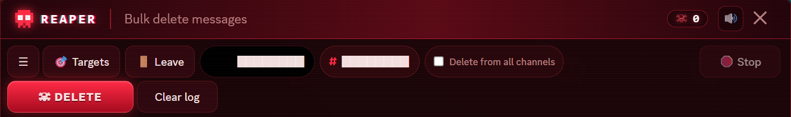
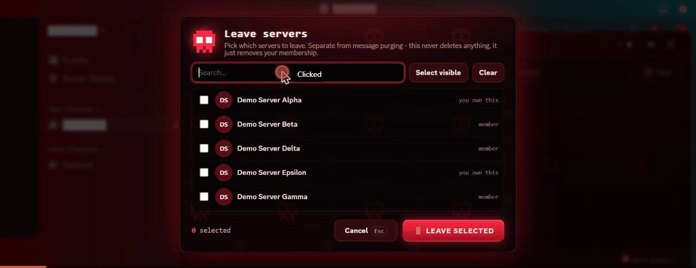
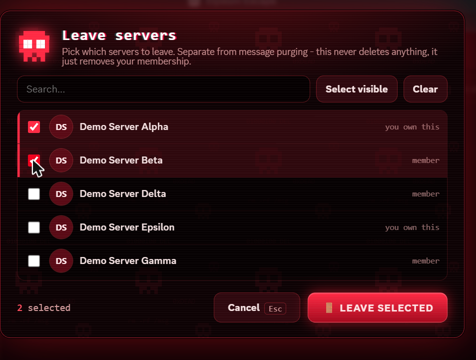
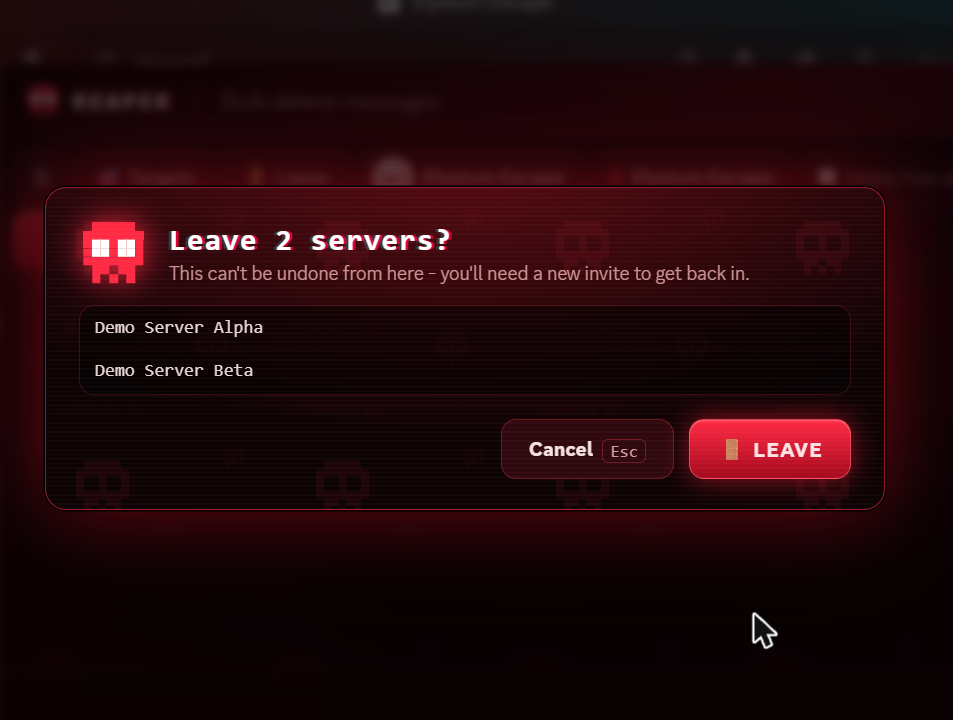
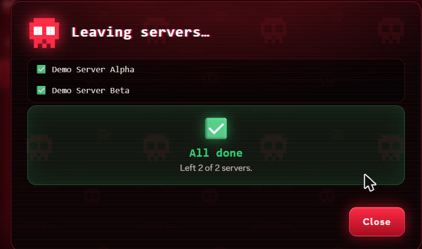

<h1 align="center">Reaper – Discord Message Purger</h1>

<b>Bulk-delete your own Discord messages, or mass-leave servers, with style.</b> 
A fork of <a href="https://github.com/victornpb/undiscord">Undiscord</a> with a new UI, theme packs, animations, sounds, speed presets and hardening patches.

  <a href="https://greasyfork.org/en/scripts/604030"><b>⬇ Install from Greasy Fork</b></a> ·
  <a href="screenshots/3-leave-confirm.png">👀 Screenshots</a> ·
  <a href="#install">Install</a>

> **✓ Official sources** – Reaper is only published by **nullreaper** on
> [Greasy Fork](https://greasyfork.org/en/scripts/604030) and here on
> [GitHub (nullreaper-dev/reaper-discord-purger)](https://github.com/nullreaper-dev/reaper-discord-purger).
> A copy from anywhere else may have been modified – install from Greasy Fork to be safe.

## What it does

- **Purge Messages** – the original Undiscord engine: search and bulk-delete your own messages across a channel, DM, or whole server, with filters (author, date range, content, attachments) and a dry-run preview mode.
- **Leave Servers** – a separate tool that mass-leaves servers you pick, using Discord's own official "leave guild" endpoint (the same action as clicking Leave Server yourself, just batched). It never touches a single message.

Both only ever act on your own account through Discord's normal web app – this is a userscript, not a bot, and it doesn't ask for or store your password.

### Leave Servers, start to finish

Pick the servers you want gone, confirm with one click, and watch it go – with a proper finish screen when it's done. Server names/icons in these shots are synthetic demo data, not a real account's server list (see Privacy below).

| Pick servers | Confirm | Done |
|---|---|---|
|  |  |  |

## Features
- **Multi-target picker** – queue up several DMs and servers and purge them in one run.
- **Filters** – author ID, date range, content match, has-link/has-file, NSFW inclusion.
- **Preview mode** – dry-run that shows exactly what would be deleted before you commit.
- **Speed presets** – Safe / Normal / Fast, or drag your own search and delete delays.
- **7 theme packs** – Blood, Toxic, Ice, Void, Ink Blade, Power Surge, Cosmic Mess.
- **Effects you can turn off** – intro animation, skull rain, kill counters, text decay, sound.
- **Compact or verbose logging**, with author-identity hiding for screenshots.
- **Rate-limit aware** – backs off automatically on Discord's own cooldowns, never guesses.
- **Leave Servers** – one-click confirm, live progress list, and a proper finish screen when it's done.
- **Android app wrapper** available alongside the userscript.

## Install
1. Install a userscript manager: [Tampermonkey](https://www.tampermonkey.net/) or [Violentmonkey](https://violentmonkey.github.io/).
2. Install Reaper from **[Greasy Fork](https://greasyfork.org/en/scripts/604030)** (or open [`reaper-discord-purger.user.js`](reaper-discord-purger.user.js) → **Raw**).
3. Open **discord.com** while logged in. Toggle the Reaper window with **Ctrl+Shift+X**.

## Privacy – what the code talks to
| Where | Why |
|---|---|
| `discord.com/api/v10/*` (Discord's own API, with your existing login) | searching and deleting your own messages, listing your DMs/servers, leaving a server |
| `cdn.discordapp.com` | avatars and server icons shown in the picker |

Nothing else. No analytics, no servers of our own, and no outside code – Reaper loads no libraries. The auth token is read from Discord's own page and is never written to storage, logged, or sent anywhere but discord.com.

## Bugs & ideas
Open an [issue](https://github.com/nullreaper-dev/reaper-discord-purger/issues) or leave a comment on the Greasy Fork page.

## Found a security issue?
Please don't post it as a public issue first – email **nullreaperdev@gmail.com** so it can be fixed before it's public. Public issues are fine for anything else.

## ⚠ Important notice
- Reaper automates actions on your Discord account. Such automation may violate Discord's Terms of Service. Use at your own risk.
- Reaper is designed to act only on your own account.
- Rate-limit handling is included, but it does not guarantee your account will never encounter restrictions or enforcement.
- Message deletion is permanent. Always use Preview mode and verify your targets and filters before confirming.
- Leaving a server is only reversible with a new invite, so double-check your selection on the confirm screen before clicking Leave.

## Licence & credits
MIT. Core bulk-deletion engine from [Undiscord](https://github.com/victornpb/undiscord) by victornpb. See [`LICENSE`](LICENSE).

*Reaper is an independent project and is not affiliated with Discord Inc.*
